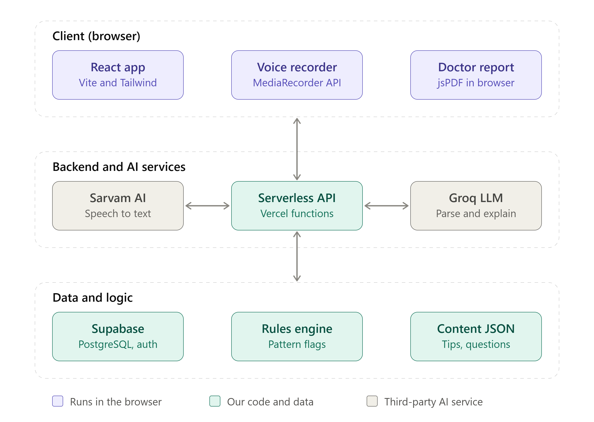

# Kaya

A women's health companion that helps women **track their cycle and symptoms (by tap or by voice in their own language)** and walk into a doctor's office with a **one-page, doctor-ready report**.

> Hackathon track: PS1, Women's Healthcare.
> Kaya does **not** diagnose. It flags patterns that are "worth discussing with a doctor".

---

## Demo and presentation

| | Link |
|---|---|
| **Demo video** (5 min) | [Watch on Google Drive](https://drive.google.com/file/d/1rOn7ib0t2tOV9FMwu4S7mhqr5ylf4S64/view?usp=drive_link) |
| **Presentation (PPT)** | [View on Google Drive](https://docs.google.com/presentation/d/1RVwQHNzYz-lTAURWLOQVsbN_daHGv-zM/edit?usp=drive_link) |
| **Live app** | [https://kaya-brown.vercel.app/](https://kaya-brown.vercel.app/) |

---

## The idea in 30 seconds

1. **Log** symptoms and periods by tapping icons or speaking in Kannada, Hindi or English.
2. **Track** the cycle with a predicted next period and phase-based tips (eat, move, avoid).
3. **Spot patterns** with simple rules (irregular cycles, recurring pain, heavy flow with fatigue), explained in friendly, age-adapted language.
4. **Generate a doctor-ready PDF**: timeline, flagged patterns, and questions to ask.

---

## System Architecture

### High-Level Architecture




### Data Flow

#### 1. Voice Logging Flow
```
User speaks → Browser captures audio → Send to /api/transcribe
↓
Sarvam AI processes → Returns transcript → Send to /api/extract
↓
LLM extracts structured data → {type, severity, area, date}
↓
Save to localStorage (demo) or Supabase (production)
↓
Display in calendar with icon badge
```

#### 2. Manual Logging Flow
```
User fills form → Create symptom object
↓
Save to localStorage (demo) or Supabase (production)
↓
Display in calendar with icon badge
```

#### 3. Pattern Detection Flow
```
Fetch logs from storage
↓
Rules engine analyzes:
  - Cycle length variation (>7 days = flag)
  - Recurring pain patterns
  - Heavy flow + fatigue combination
  - Sleep disturbances
↓
Generate flags array
↓
LLM converts flags to age-appropriate, friendly text
↓
Display in Insights page
```

#### 4. Report Generation Flow
```
User selects timeframe (1/2/3 months)
↓
Fetch user data + cycle logs + symptom logs
↓
Run rules engine to generate flags
↓
Generate report structure:
  - Patient info
  - Cycle timeline
  - Flagged patterns
  - Clinical note
  - Suggested questions
↓
Render to UI
↓
User clicks "Download PDF" → Browser print dialog → Save as PDF
```

### Component Architecture

```
App.jsx (Router)
├── Onboarding.jsx (2-step setup)
│   ├── Step 1: Name input
│   └── Step 2: Life stage selection
├── Home.jsx (Dashboard)
│   ├── CycleRing.jsx (Visual cycle tracker)
│   ├── QuickLogRow.jsx (Fast symptom entry)
│   ├── TipsCard.jsx (Phase-based wellness tips)
│   └── TrendCard.jsx (Pain trends visualization)
├── Calendar.jsx (Monthly view)
│   ├── Calendar grid
│   ├── Period days highlighting
│   └── Symptom indicators
├── Log.jsx (Entry form)
│   ├── Voice mode (with VoiceLogSheet)
│   └── Manual mode (form inputs)
├── Insights.jsx (Pattern analysis)
│   ├── Trend visualization
│   └── Flagged patterns display
└── Report.jsx (Doctor report)
    ├── Timeline view
    ├── Flagged patterns
    └── PDF generation
```

---

## Tech Stack

| Layer | Technology | Purpose |
|-------|-----------|---------|
| **Frontend** | React 19 + Vite 8 | UI framework and build tool |
| **Styling** | Tailwind CSS 4 | Utility-first CSS framework |
| **Routing** | React Router 7 | Client-side routing |
| **Backend** | Express.js 5 | Local development server |
| **Database** | Supabase (PostgreSQL) | User data, cycle logs, symptom logs |
| **Authentication** | Supabase Auth | User management |
| **Voice (STT)** | Sarvam AI | Speech-to-text for Kannada, Hindi, English |
| **LLM** | Groq / Gemini | Extract symptoms from transcripts, generate insights |
| **PDF Generation** | Browser Print API | Doctor-ready reports |
| **Internationalization** | Custom i18n system | Multi-language support (en, kn, hi) |
| **Icons** | Google Material Symbols | Consistent iconography |
| **Fonts** | Poppins, Noto Sans Kannada, Noto Sans Devanagari | Typography |

### Technology Choices Rationale

- **React + Vite**: Fast development, hot reload, optimal build performance
- **Tailwind CSS**: Rapid UI development, consistent design system, small bundle size
- **Supabase**: Complete backend solution (auth, database, real-time) with generous free tier
- **Sarvam AI**: Specialized in Indian languages, better performance for local languages
- **Groq LLM**: Fast inference, low latency for real-time insights
- **Browser Print API**: Native PDF generation without heavy libraries, works offline

---

## Getting Started

### Prerequisites

- Node.js 18+ 
- npm or yarn
- Git

### Installation

```bash
# Clone the repository
git clone https://github.com/<your-username>/kaya.git
cd kaya

# Switch to dev branch
git checkout dev

# Install dependencies
npm install

# Copy environment variables template
cp .env.example .env

# Fill in your API keys in .env
# (See Environment Variables section below)
```

### Running the Application

#### Option 1: Full Stack (Recommended for Development)

```bash
# Start the combined server (frontend + API)
npm run dev:server

# Application runs at http://localhost:3000
```

#### Option 2: Frontend Only

```bash
# Start only the Vite dev server
npm run dev

# Frontend runs at http://localhost:5173
# Note: API endpoints will need to be mocked or run separately
```

### Environment Variables

Create a `.env` file in the root directory:

```env
# Supabase Configuration
SUPABASE_URL=your_supabase_project_url
SUPABASE_ANON_KEY=your_supabase_anon_key
SUPABASE_SERVICE_KEY=your_supabase_service_key

# AI Services
SARVAM_API_KEY=your_sarvam_api_key
LLM_API_KEY=your_groq_or_gemini_api_key
LLM_PROVIDER=groq  # or 'gemini'

# Optional: Demo Mode
DEMO_MODE=true  # If true, uses mock data instead of real APIs
```

**Important Security Notes:**
- Never commit `.env` to version control (it's in `.gitignore`)
- Only variables prefixed with `VITE_` are exposed to the browser
- Keep `SARVAM_API_KEY` and `LLM_API_KEY` server-side only
- Rotate keys immediately if leaked

---

## Project Structure

```
kaya/
├── api/                          # Backend API endpoints
│   ├── transcribe.js             # Speech-to-text (Sarvam AI)
│   ├── extract.js                # Extract symptoms from transcript (LLM)
│   ├── report.js                 # Generate doctor report data
│   ├── logs.js                   # CRUD operations for symptom logs
│   ├── users.js                  # User registration and management
│   └── _lib/                     # Shared backend utilities
│       ├── supabase.js           # Supabase client configuration
│       ├── rules.js              # Pattern detection rules engine
│       ├── llm.js                # LLM API wrapper
│       ├── sarvam.js             # Sarvam AI API wrapper
│       └── fallbacks.js          # Demo/mock responses
│
├── db/                           # Database schema and seed data
│   ├── schema.sql                # Supabase table definitions
│   ├── seed.js                   # Demo patient data seeding
│   └── test-rules.js             # Rules engine testing
│
├── src/                          # Frontend React application
│   ├── components/               # Reusable UI components
│   │   ├── BottomNav.jsx         # Bottom navigation bar
│   │   ├── CycleRing.jsx         # Visual cycle tracker
│   │   ├── QuickLogRow.jsx       # Quick symptom entry
│   │   ├── TipsCard.jsx          # Phase-based wellness tips
│   │   ├── TrendCard.jsx         # Pain trend visualization
│   │   ├── InsightCard.jsx       # Pattern insight display
│   │   ├── ReportButton.jsx      # Report generation button
│   │   └── VoiceLogSheet.jsx     # Voice input bottom sheet
│   │
│   ├── pages/                    # Page components
│   │   ├── Onboarding.jsx        # 2-step user onboarding
│   │   ├── Home.jsx              # Main dashboard
│   │   ├── Calendar.jsx          # Monthly calendar view
│   │   ├── Log.jsx               # Symptom logging (voice/manual)
│   │   ├── Insights.jsx          # Pattern analysis and trends
│   │   └── Report.jsx           # Doctor-ready report
│   │
│   ├── lib/                      # Frontend utilities
│   │   ├── api.js                # API client functions
│   │   ├── useVoiceRecorder.js   # Custom voice recording hook
│   │   └── mock/                 # Mock data for development
│   │       ├── user.js
│   │       ├── cycle.js
│   │       ├── symptoms.js
│   │       └── report.js
│   │
│   ├── i18n/                     # Internationalization
│   │   ├── index.jsx             # i18n provider
│   │   ├── en.json               # English translations
│   │   ├── kn.json               # Kannada translations
│   │   └── hi.json               # Hindi translations
│   │
│   ├── App.jsx                   # Main app with routing
│   ├── main.jsx                  # Application entry point
│   └── index.css                 # Global styles
│
├── public/                       # Static assets
│
├── server.js                     # Express development server
├── vite.config.js                # Vite configuration
├── tailwind.config.js            # Tailwind theme configuration
├── eslint.config.js              # ESLint configuration
├── package.json                  # Dependencies and scripts
├── .env.example                  # Environment variables template
├── .gitignore                    # Git ignore rules
└── README.md                     # This file
```

---

## Features

### 1. Onboarding
- **2-step flow**: Name → Life stage selection
- **Age-adapted**: Different options for teens, adults, perimenopause
- **Demo mode**: Auto-populates with Priya's data for hackathon demo

### 2. Home Dashboard
- **Cycle Ring**: Visual representation of current cycle day and phase
- **Quick Log**: Fast symptom entry with one tap
- **Phase Tips**: Contextual wellness tips based on cycle phase
- **Trend Visualization**: Pain trends over time
- **Pattern Alerts**: Warnings for irregular cycles or concerning patterns

### 3. Calendar View
- **Monthly grid**: Easy to navigate through months
- **Period highlighting**: Visual indication of period days
- **Symptom indicators**: Color-coded dots for logged symptoms
- **Cycle status**: Current day and phase display
- **Interactive**: Click any day to view/edit logs

### 4. Symptom Logging
- **Voice Mode**: Speak symptoms in Kannada, Hindi, or English
  - Real-time transcription via Sarvam AI
  - Automatic extraction of type, severity, area
  - Editable before saving
- **Manual Mode**: Traditional form-based entry
  - Date picker
  - Symptom type dropdown
  - Severity slider (1-5)
  - Area selection
  - Optional notes

### 5. Insights & Patterns
- **Rules Engine**: Detects concerning patterns
  - Irregular cycles (>7 day variation)
  - Recurring pain
  - Heavy flow with fatigue
  - Sleep disturbances
- **Age-Appropriate Language**: Friendly explanations adapted to life stage
- **Visual Trends**: Charts showing patterns over time
- **Doctor Questions**: Suggested questions based on detected patterns

### 6. Doctor Report
- **Timeframe Selection**: 1, 2, or 3 months
- **Comprehensive Data**:
  - Patient information
  - Cycle timeline with severity indicators
  - Flagged patterns with explanations
  - Clinical summary note
  - Suggested doctor questions
- **PDF Export**: Browser print dialog for professional reports
- **Privacy-First**: All data stays on device (demo mode)

---

## Demo Mode

For the hackathon demo, the app runs in **demo mode** with mock data:

### Demo User Profile
- **Name**: Priya
- **Age**: 19
- **Life Stage**: Teen
- **Cycle Length**: 30 days (varied)
- **Current Phase**: Ovulation (Day 16)

### Demo Data
- **3 months of cycle logs**: August, September, October 2026
- **20+ symptom logs**: Pain, mood, sleep, fatigue, headache, bloating, nausea
- **Variation**: 7-day cycle variation between cycles
- **Patterns**: Recurring headaches, sleep disturbances, heavy flow

### Demo Features
- **No API keys required**: Works offline with mock data
- **Instant loading**: No network latency
- **Consistent experience**: Same data every time
- **Voice simulation**: Mock transcription for demo purposes

---

## API Endpoints

### `/api/users`
- **POST**: Register new user
- **GET**: Fetch user profile

### `/api/logs`
- **GET**: Fetch symptom logs with date range
- **POST**: Save new symptom log
- **PUT**: Update existing log
- **DELETE**: Remove log

### `/api/transcribe`
- **POST**: Convert audio to text (Sarvam AI)
- Input: `{ audio: base64, mimeType: string, language: string }`
- Output: `{ transcript: string }`

### `/api/extract`
- **POST**: Extract structured symptoms from transcript (LLM)
- Input: `{ transcript: string, language: string }`
- Output: `{ entries: [{ type, severity, area, date, note }] }`

### `/api/report`
- **GET**: Generate report data for PDF
- Query params: `userId`, `timeframe`
- Output: `{ patient, cycles, flaggedPatterns, clinicalNote, suggestedQuestions }`

---

## Rules Engine

The rules engine analyzes logged data to detect concerning patterns:

### Rule: Irregular Cycle
- **Condition**: Cycle length varies by >7 days over 3 cycles
- **Severity**: High
- **Suggested Action**: Discuss with doctor

### Rule: Recurring Pain
- **Condition**: Pain severity 4+ in 3+ consecutive cycles
- **Severity**: Medium
- **Suggested Action**: Track and discuss if persists

### Rule: Heavy Flow + Fatigue
- **Condition**: Heavy flow (4+) with high fatigue (4+) in same cycle
- **Severity**: High
- **Suggested Action**: Discuss with doctor (possible anemia)

### Rule: Sleep Disturbances
- **Condition**: Sleep issues reported in 2+ consecutive cycles
- **Severity**: Medium
- **Suggested Action**: Monitor stress levels, discuss if worsens

---

## Design System

### Color Palette
- **Primary Coral**: `#EE8070` (actions, emphasis)
- **Light Peach**: `#F6D1C5` (insights, backgrounds)
- **Peach**: `#F4A990` (highlights)
- **Deep Coral**: `#9d4235` (text, accents)
- **White**: `#FFFFFF` (cards, backgrounds)
- **Black**: `#000000` (text, borders)

### Typography
- **Primary**: Poppins (headings, body)
- **Kannada**: Noto Sans Kannada
- **Hindi**: Noto Sans Devanagari

### Design Style
- **Soft Neubrutalism**: Thick black outlines, hard offset shadows
- **Rounded Corners**: Consistent 12-24px radius
- **Playful but Professional**: Approachable healthcare design

---

## Git Workflow

```
main        ← Production-ready, auto-deploys to Vercel
 └── dev    ← Integration branch
      ├── feat/data-...   (Data layer features)
      ├── feat/ai-...     (AI/Voice features)
      └── feat/ui-...     (UI/UX features)
```

### Branch Naming
- `feat/feature-name`: New features
- `fix/bug-description`: Bug fixes
- `refactor/component-name`: Code refactoring
- `docs/update-description`: Documentation updates

### Commit Message Format
```
type(scope): description

feat(report): add PDF generation
fix(calendar): correct cycle day calculation
refactor(onboarding): simplify state management
docs(readme): update architecture section
```

---

## Deployment

### Vercel Deployment (Production)

```bash
# Install Vercel CLI
npm i -g vercel

# Login to Vercel
vercel login

# Link project
vercel link

# Deploy
vercel --prod
```

### Environment Variables in Vercel
1. Go to Project Settings → Environment Variables
2. Add all variables from `.env.example`
3. Redeploy after adding variables

### Deployment Checklist
- [ ] All environment variables set
- [ ] Build succeeds (`npm run build`)
- [ ] Voice recording tested (requires HTTPS)
- [ ] PDF generation tested
- [ ] All pages load without errors
- [ ] Demo mode works as fallback

---

## Browser Compatibility

- **Chrome/Edge**: Full support (recommended)
- **Firefox**: Full support
- **Safari**: Full support (iOS 14+)
- **Voice Recording**: Requires HTTPS (localhost or production)
- **PDF Generation**: Requires browser print support

---

## Performance Considerations

- **Lazy Loading**: Components loaded on demand
- **Image Optimization**: Use WebP format
- **Bundle Size**: Tree-shaking enabled
- **API Caching**: Response caching for repeated requests
- **LocalStorage**: Fast data access for demo mode

---

## Security

- **API Keys**: Never exposed to client (server-side only)
- **Authentication**: Supabase Row-Level Security (RLS)
- **Data Encryption**: Supabase handles encryption at rest
- **HTTPS Required**: For voice recording in production
- **Input Validation**: All user inputs sanitized
- **Rate Limiting**: Applied to API endpoints

---

## Accessibility

- **Semantic HTML**: Proper heading hierarchy
- **ARIA Labels**: Screen reader support
- **Keyboard Navigation**: Full keyboard accessibility
- **Color Contrast**: WCAG AA compliant
- **Touch Targets**: Minimum 44x44px for mobile
- **Font Scaling**: Respects user font size preferences

---

## Future Enhancements

### Phase 2 Features
- [ ] Temperature tracking for ovulation confirmation
- [ ] Cervical mucus logging
- [ ] Integration with health apps (Apple Health, Google Fit)
- [ ] Reminder notifications
- [ ] Dark mode support
- [ ] More languages (Tamil, Telugu, Malayalam)

### Phase 3 Features
- [ ] Community features (anonymous)
- [ ] Doctor directory integration
- [ ] Telehealth booking
- [ ] AI-powered personalized recommendations
- [ ] Wearable device integration

---

## Troubleshooting

### Voice Recording Not Working
- Ensure HTTPS is enabled (required for microphone access)
- Check browser permissions for microphone
- Verify Sarvam API key is set
- Try with shorter audio clips (<30 seconds)

### PDF Generation Issues
- Use Chrome/Edge for best print support
- Check browser pop-up blocker settings
- Ensure CSS is loaded before printing
- Try landscape orientation if layout is cut off

### API Errors
- Verify all environment variables are set
- Check Supabase project is active
- Ensure API keys have correct permissions
- Check browser console for specific error messages

### Build Failures
- Clear node_modules: `rm -rf node_modules && npm install`
- Check Node.js version (requires 18+)
- Verify all dependencies are compatible
- Check for TypeScript errors if applicable

---

## Contributing

### For Team Members

1. **Create feature branch** from `dev`
2. **Make changes** in your assigned area
3. **Test thoroughly** before committing
4. **Write clear commit messages**
5. **Create Pull Request** to `dev`
6. **Request review** from teammate
7. **Merge after approval**

### Code Style
- Use 2-space indentation
- Prefer functional components with hooks
- Add comments for complex logic
- Keep components under 300 lines
- Extract reusable logic to custom hooks

### Testing
- Test voice recording on actual device
- Verify PDF output looks correct
- Check responsive design on mobile
- Test demo mode fallback
- Verify error handling

---

## License

This project is created for the PS1 Women's Healthcare hackathon.

---

## Disclaimer

Kaya is a tracking and communication aid, not a medical device. It does not diagnose conditions. Wellness tips are general, and users should talk to a doctor about any concerns. Always consult a healthcare professional for medical advice.

---

## Team & Credits

- **Track**: PS1, Women's Healthcare
- **Tech Stack**: React, Vite, Tailwind, Supabase, Sarvam AI, Groq
- **Design**: Soft neubrutalism inspired by modern healthcare apps
- **Languages**: English, Kannada, Hindi

---

## Contact & Support

For questions or issues during the hackathon:
- Check the troubleshooting section above
- Review the API contract in `docs/api-contract.md`
- Test with demo mode first before using real APIs

---

**Built with ❤️ for women's health**
